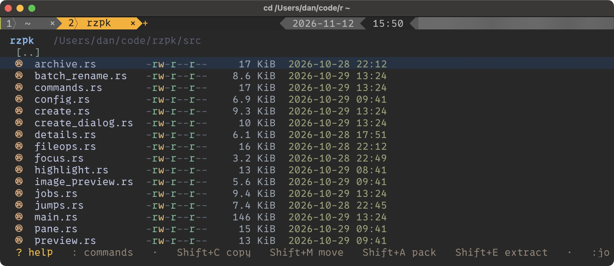
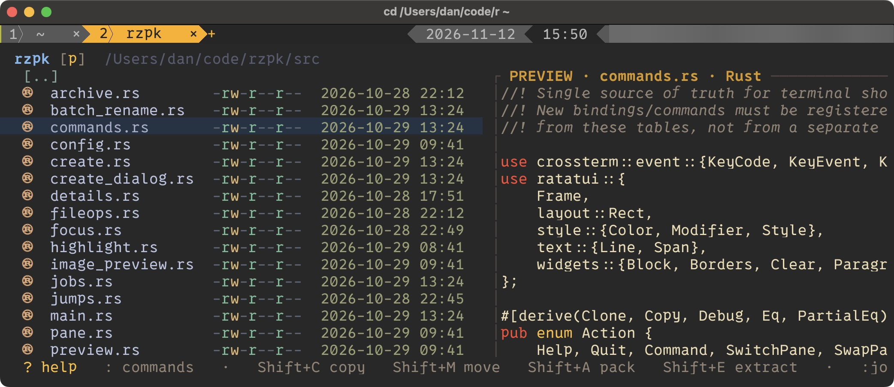
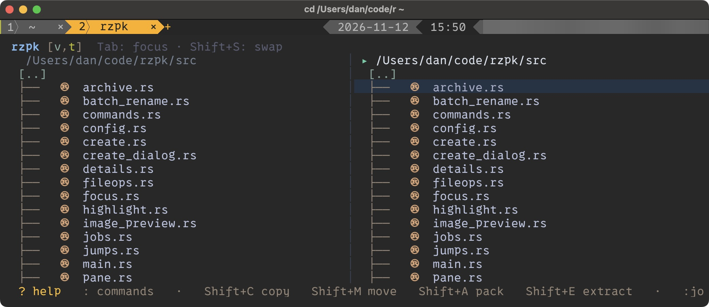

<h1 align="center">rzpk</h1>
<p align="center"><strong>A keyboard-first terminal file browser</strong></p>

A small file browser for **macOS** and **Linux**, written in Rust.
Browse local files, combine splits, trees and previews, and transfer files over
SFTP without leaving your terminal.

## The browser

rzpk opens in the **current working directory**. Directories come first, followed
by files with Nerd Font icons, Unix permissions, human-readable sizes and local
modification times. Dates fade from green to slate as files get older; metadata
columns disappear in narrow windows to keep filenames visible.



Type a filename to jump to it, use **← / →** to move between folders, and press
**Enter** to open a file in your editor. Each pane remembers its directory focus
and scroll position for the current session.

Enable **`:p`** for syntax-colored source previews, directory contents and images.
Text uses a built-in Gruvbox Dark palette; images use terminal graphics where
available and Unicode half-blocks elsewhere.



Open **`:v`** for two independent panes and **`:t`** for a lazy tree. These modes
combine with previews. **Tab** switches focus; **Shift+S** swaps the panes.
Copy or move marked entries to the other pane, with confirmation and background
progress in the footer.



Screenshots captured in [rst](https://github.com/dme86/rst) on macOS.

## Shortcuts

| Action | Shortcut |
| --- | --- |
| Move highlight | **↑ / ↓** |
| Parent / enter folder | **← / →** |
| Open folder or file in editor | **Enter** |
| Find by filename | **Type letters** |
| Toggle mark | **Space** |
| Extend / shrink selection | **Shift+↑ / ↓** or **Shift+K / J** |
| Select all regular files / clear | **Ctrl+A** |
| Switch / swap split panes | **Tab / Shift+S** |
| Copy / move to other pane | **Shift+C / Shift+M** |
| Create file or folder | **Shift+N** |
| Batch rename | **Shift+R** |
| Pack / extract archive | **Shift+A / Shift+E** |
| View waiting jobs | **Shift+Q** or **`:jobs`** |
| Jump to saved directory | **Ctrl+G**, then **1–9** |
| Toggle split / preview / tree | **`:v` / `:p` / `:t`**, then **Enter** |
| Return to single-list view | **`:n`**, then **Enter** |
| Clear marks / cancel command or dialog | **Esc** |
| Keyboard help | **?** |
| Quit | **Ctrl+C** or **`:q`**, then **Enter** |

Commands start with **:** and run with **Enter**. Search matches filename prefixes
first, then substrings, and resets after 900 ms. **Esc** keeps your current view;
use the mode command again to toggle it off. The built-in **?** help includes the
full shortcut and command reference.

## Get started

Install [Rust](https://rustup.rs/), then:

```sh
git clone https://github.com/dme86/rzpk.git
cd rzpk
make run
```

Install an optimized binary on macOS or Linux:

```sh
make install
```

This installs to `~/.local/bin` without sudo and adds an idempotent PATH entry
for your login shell (**zsh**, **bash** or **fish**). Open a new terminal, then
run `rzpk` from any directory. `make install-macos` is an alias: rzpk runs inside
your existing terminal and needs no app bundle.

Use `make setup-path` to repeat shell setup, or
`make install SETUP_PATH=0` to leave shell configuration untouched.
Override shell detection with `USER_SHELL=/bin/zsh`. zsh respects `ZDOTDIR`;
fish respects `XDG_CONFIG_HOME`. Bash setup covers interactive and login shells.
Unsupported shells receive a manual PATH hint.

A custom location works with `make install PREFIX=/usr/local SETUP_PATH=0`
(write permission is required). `DESTDIR` supports package staging and disables
shell changes. `make uninstall` removes the installed binary while keeping your
config and PATH entries. Alternatively, use `cargo install --path .` with
Cargo's own installation directory.
Use a [Nerd Font](https://www.nerdfonts.com/) in your terminal for the file icons.
Files open with `$EDITOR`, falling back to `$VISUAL`, then `vi`; editor commands
with arguments are supported.

## Configure

Create `~/.config/rzpk/config.toml` (or `$XDG_CONFIG_HOME/rzpk/config.toml`).
No config file is needed for the defaults.

```toml
metadata_position = "right" # filename first; "left" puts metadata first

[jumps]
1 = "~/.config"
2 = "~/projects"

[connections.nas]
host = "nas"              # SSH alias or user@host
path = "/volume1/projects"
```

Save the active directory with **`:jset 1`**, jump with **Ctrl+G, then 1** or
**`:j1`**, and remove a slot with **`:jdel 1`**. Up to nine jumps are persisted in
the config; a compact strip shows them above each pane. **Option/Alt+1–9** also
works when your terminal sends Alt+digits. Restart after manual config changes.

Enter **`:connect nas`** to open an SFTP connection. rzpk uses the installed
OpenSSH client, your SSH configuration and existing authentication, with strict
known-host verification. Set up access with `ssh nas` first. **Shift+C / Shift+M**
transfer between local and remote panes; **`:disconnect`** returns to local files.

## File operations

Copy, move, batch rename, packing and extraction run in a background queue with
footer progress. Review the confirmation before starting; existing targets are
not silently overwritten. **`:jobs`** lets you remove waiting jobs. Active work
cannot currently be canceled, and quitting waits for the queue to finish.

Create `.tar.gz` archives and extract **ZIP, TAR, TAR.GZ, TAR.XZ and TAR.BZ2** into
a new subfolder. Batch rename keeps file extensions and adds sequence numbers;
it currently supports local regular files only. A failed multi-item job may
leave earlier completed items in place.

See the [user guide](docs/user-guide.md) for selection behavior, directory jumps,
SFTP limits, image previews, archive safeguards and terminal key configuration.

## Development

```sh
make test
make lint
make release
```

`make` lists all targets. `make test-install` checks shell PATH setup in temporary
homes (Python 3; shells that are not installed are skipped).

Shortcuts and commands are registered in [`src/commands.rs`](src/commands.rs),
which also generates the built-in help. rzpk is under active development.

MIT licensed.
